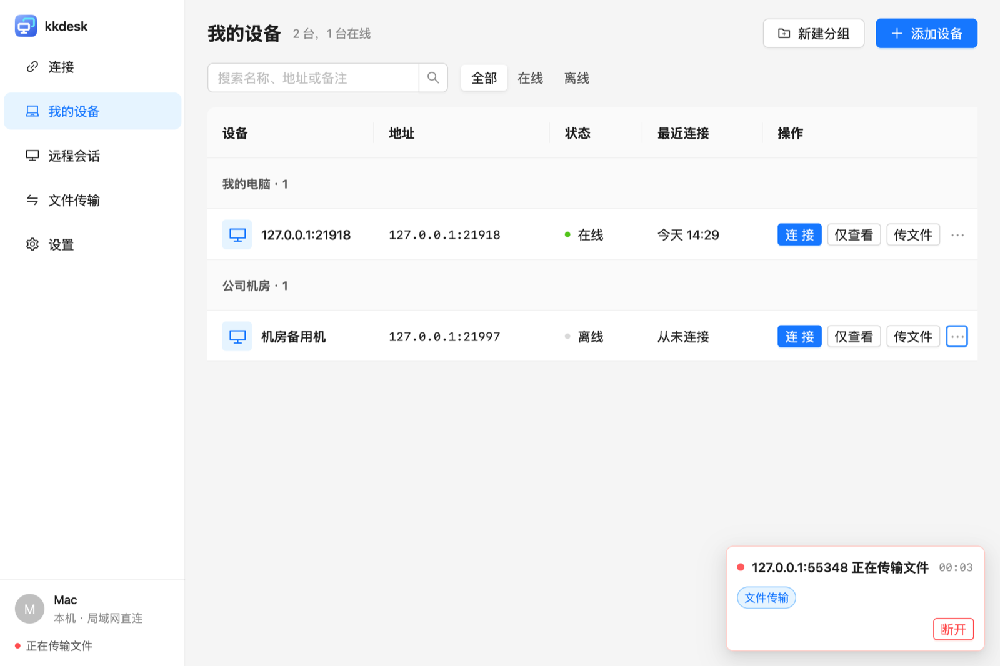
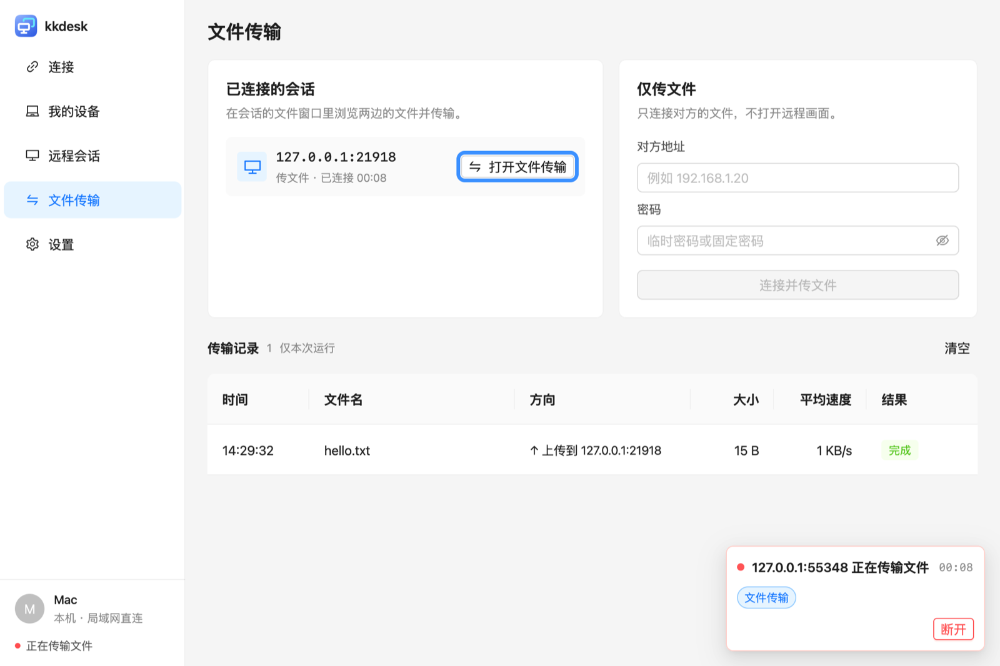
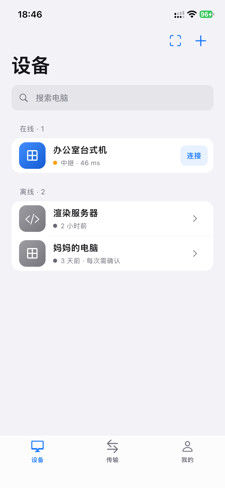
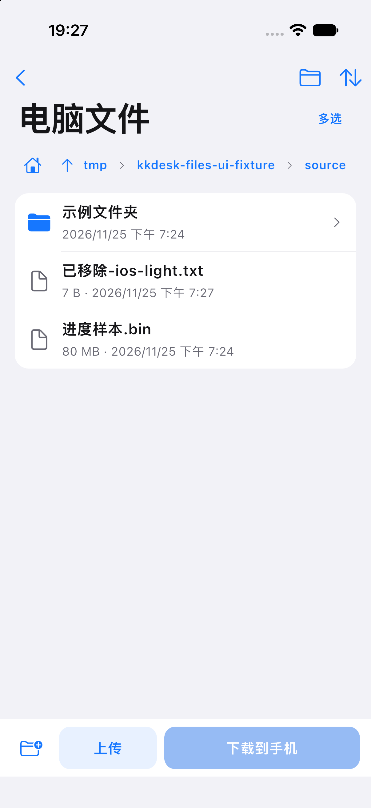

# kkdesk

[English](README.md) | [简体中文](README.zh-CN.md) | **日本語**

Go と [Tango](https://github.com/tangoui/tango) で作ったネイティブのリモートデスクトップです。UI は自前で描画し、リモート画面は OS ネイティブのビデオビューで表示します。両端ともハードウェア H.264 でエンコード・デコードします。

1 つのアプリが 2 つの役割を持ちます。このコンピューターの画面を共有するホストと、相手を表示・操作するコントローラーです。LAN ではアドレスとパスワードで接続し、ネットワークをまたぐ場合は自分でホストするサーバー経由でデバイスコードを使って接続します。サードパーティのクラウドもアカウント登録も不要です。

> アプリの画面は現在中国語のみです。以下の設定名は訳語です。

> **現状：プロトタイプ。** 動作しますが、最初の正式リリースはまだです。両端は同じバージョンである必要があります（接続認証 v2 は以前のビルドと互換性がありません）。

## スクリーンショット

### デスクトップ（macOS）

| マイデバイス | ファイル転送 |
| --- | --- |
|  |  |

### モバイル（iOS）

| デバイス一覧（iPhone） | コンピューターのファイルを閲覧 |
| --- | --- |
|  |  |

## 機能

- **リモート操作と表示のみ**：セッション中の「コントロールセンター」で画質、フレームレート、表示のみ、ウィンドウサイズを切り替えられます。リモート画面上ではホスト側のカーソル形状（指、テキスト、リサイズなど）がそのまま表示されます。
- **ファイル転送**：ファイルとフォルダーの閲覧、アップロード、ダウンロード。チェックサム検証、キャンセル、セッションごとの許可設定付き。
- **クリップボード同期**：テキストを同期。セッションごとにオフにできます。
- **プライバシースクリーン**：ホストのすべてのディスプレイを黒くし、コントローラーはそのままデスクトップを見て操作できます。ホスト側で「許可しない / 毎回確認 / 常に許可」を選べます。
- **画面ロック**：切断時に自動でロック（予期しない切断には猶予時間あり）、またはコントロールセンターから「ロックして切断」。
- **リモートロック解除**（オプションのコンポーネント）：ホストにロック画面コンポーネントを入れると、コントローラーからロック画面を表示して解除できます。パスワードはコントローラー側のキーチェーンに保存できます。
- **セキュリティ**：ホストは応答ごとにデバイス ID で署名し、コントローラーはデバイスコードまたは LAN アドレスごとに記憶した ID と照合します。パスワードは暗号化された DTLS チャネル内でのみ検証し、連続して間違えるとパスワードでのログインを一時停止します。
- **マイデバイス**：グループとオンライン確認付きのアドレス帳、セッション履歴、固定パスワードと一時パスワードの更新ポリシー。データはすべてローカルに保存されます。
- **モバイルアプリ**（Flutter、`mobile/`）：QR コードでペアリングし、コンピューターを操作、ファイルを閲覧・転送できます。
- **セルフホストのネットワーク越えサービス**（`kkdesk-server`）：デバイスコードのシグナリングと TURN リレー。クライアントは WebRTC の直接接続かリレーを自動で選びます。

## 対応プラットフォーム

| プラットフォーム | ホスト（画面共有） | コントローラー | 備考 |
| --- | --- | --- | --- |
| macOS | ✅ | ✅ | ScreenCaptureKit、VideoToolbox H.264、AVSampleBufferDisplayLayer、CGEvent |
| Windows x64 | ✅（実機で検証中） | ✅ | DXGI Desktop Duplication、Media Foundation H.264、D3D11 ビデオプロセッサー、SendInput |
| Linux x64 / arm64 | — | ファイル転送のみ | 画面キャプチャとリモート表示は未実装 |
| iOS / Android | — | ✅ | `mobile/` の Flutter アプリ |

## はじめかた

OS と CPU に合ったインストーラーをダウンロードしてください。macOS では DMG を開き、kkdesk を「アプリケーション」にドラッグします。Windows x64 では `setup.exe` を実行し、現在のユーザー用にインストールします。Linux x64 または ARM64 では AppImage を使うか、Debian や Ubuntu に deb をインストールします。 [GitHub Releases](https://github.com/tangoui/kkdesk/releases)

1. 操作される側のコンピューターで **リモート操作を許可** をオンにします。接続ページに LAN アドレス、一時パスワード、そしてネットワーク越えサービスを設定していれば `KD-…` で始まるデバイスコードが表示されます。
2. 操作する側でアドレスまたはデバイスコードとパスワードを入力し、**接続** を押します。「接続前に確認する」がオンの場合は、ホスト側で承認します。

macOS のホストには「画面収録」の権限が、操作されるには「アクセシビリティ」の権限が必要です。詳しくは [ユーザーガイド](https://tangoui.github.io/kkdesk/)（中国語）を参照してください。

## ソースからビルド

Go 1.27 と [`tan`](https://github.com/tangoui/tango/tree/main/cmd/tan) が必要です。cgo を使います。

```sh
tan dev                                    # ホットリロード付きでメインウィンドウを起動
CGO_ENABLED=1 go build -o kkdesk .          # macOS 向けビルド
./kkdesk -host                             # ホスト：アドレスと一時パスワードを表示
./kkdesk -connect 192.168.1.20:21118 -password 123456   # コントローラー
./kkdesk -selftest                         # キャプチャ・エンコード・入力のセルフテスト
scripts/build-windows.sh                   # macOS 上で kkdesk.exe をクロスビルド（mingw-w64 が必要）
```

## セルフホストのネットワーク越えサービス

`kkdesk-server` はパブリック IPv4 を持つ Linux サーバーで動き、ドメインと HTTPS、または IP アドレスと公開鍵のピン留めのどちらでも使えます。Debian / Ubuntu の場合：

```sh
curl -fsSL -o install-server.sh https://raw.githubusercontent.com/tangoui/kkdesk/main/scripts/install-server.sh &&
  sudo bash install-server.sh desk.example.com 203.0.113.10
```

その後、両方のコンピューターの「設定 › ネットワーク越え接続」に同じサーバーアドレスとサービストークンを入力します。ポート、手動セットアップ、設定ファイルについては [デプロイガイド](https://tangoui.github.io/kkdesk/deploy/server.html)（中国語）を参照してください。

## ライセンス

[GNU AGPL-3.0](LICENSE)
