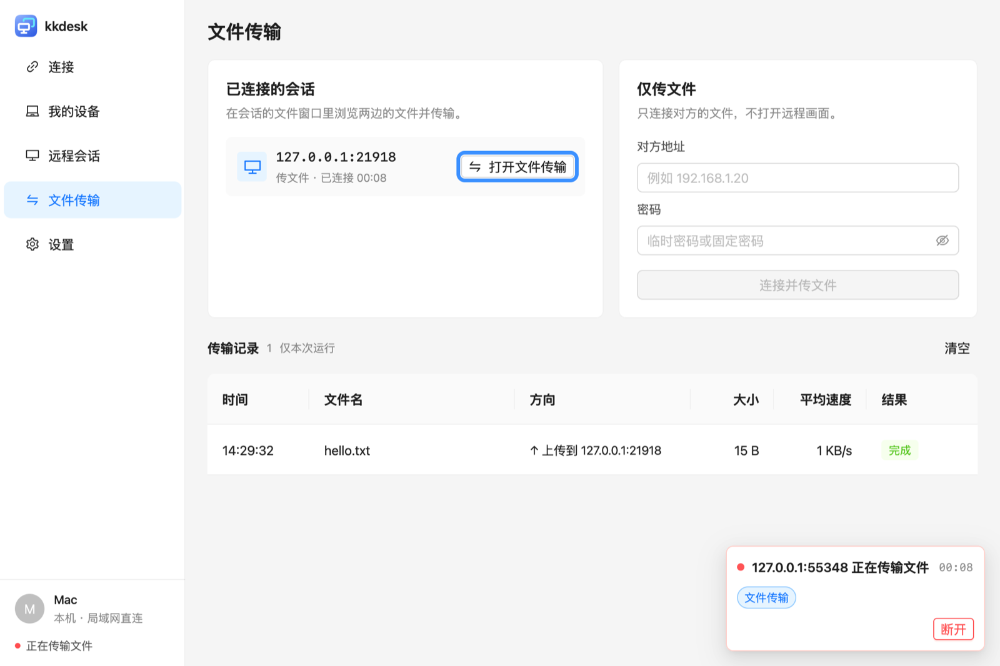
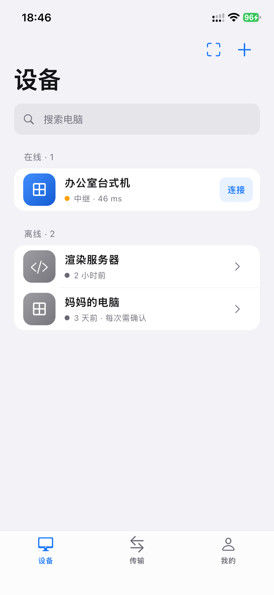
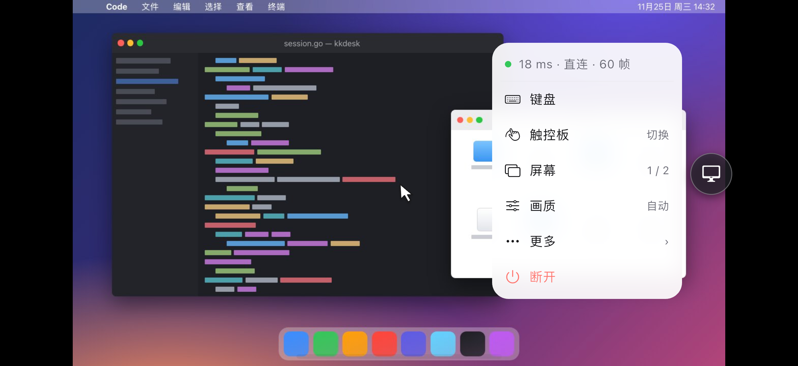

# kkdesk

用 [Tango](https://github.com/tangoui/tango) 写的远程桌面：Go 程序，自绘界面，远端画面用系统原生视频视图显示。

一个程序两种角色：被控端共享本机屏幕，控制端查看或控制对方。局域网可用地址和密码连接。异地设备可用自托管跨网服务，通过设备码连接。

## 界面截图

### 电脑端（macOS）

| 我的设备 | 文件传输 |
| --- | --- |
|  |  |

### 手机端（iOS）

| 设备列表（iPhone 真机） | 浏览电脑文件 |
| --- | --- |
|  |  |

远控菜单（演示会话）



## 现状（验证原型）

- macOS：被控端和控制端都可用。屏幕采集用 ScreenCaptureKit，编解码用 VideoToolbox H.264 硬件编解码，画面用 `AVSampleBufferDisplayLayer` 显示。
- Windows：控制端可用（已实测控制 Mac），被控端实机验证中。采集用 DXGI Desktop Duplication，编解码用 Media Foundation H.264（优先硬件），画面用 D3D11 视频处理器和 flip 交换链显示，注入用 SendInput。
- 传输：Pion WebRTC。视频是 H.264 RTP，输入、画质切换、时钟同步和文件传输走数据通道。局域网连接用临时或固定密码。跨网设备码连接每次都要求对方确认。
- 文件传输：浏览、上传下载文件和文件夹、校验、取消、权限开关；「文件传输」页列出会话和本次运行的传输记录。
- 我的设备、远程会话、设置：通讯录（分组、在线探测）、会话列表、固定密码与临时密码更换策略、端口、主题，数据只存本机。
- Mac 自连测量见 [docs/spike-report.md](docs/spike-report.md)：延迟中位数 33 ms、P95 50 ms；帧率受系统屏幕采集降频影响，约 30 fps。

设计与计划：
- [docs/superpowers/specs/2026-11-24-kkdesk-spike-design.md](docs/superpowers/specs/2026-11-24-kkdesk-spike-design.md)
- [docs/superpowers/plans/](docs/superpowers/plans/)
- 界面原型：[docs/design/prototype.html](docs/design/prototype.html)

## 构建与运行

需要 Go 1.27 和 [`tan`](https://github.com/tangoui/tango/tree/main/cmd/tan)。项目用到 cgo（`tan.json` 里 `"cgo": true`）。

```sh
tan dev                                   # 打开主窗口，热重载
CGO_ENABLED=1 go build -o kkdesk .         # macOS 构建
./kkdesk -host                            # 被控端：打印本机地址和临时密码
./kkdesk -connect 192.168.1.20:21118 -password 123456   # 控制端
./kkdesk -selftest                        # 采集、编码、注入自检
```

Windows 版在 macOS 上交叉编译（需要 mingw-w64）：

```sh
scripts/build-windows.sh                  # 产出 kkdesk.exe 和说明
```

测量：`scripts/loopback.sh <输出目录> [秒数]`（本机自连），汇总用 `go run ./scripts/summary <日志...>`。

## 自托管跨网服务

`kkdesk-server` 提供设备码信令和 TURN 中继。客户端自动选择 WebRTC 直连或中继。服务端可在有公网 IPv4 的 Linux 服务器上使用 IP + 公钥或域名 HTTPS。[IP + 公钥安装与客户端配置](https://tangoui.github.io/kkdesk/deploy/server.html#公网-ip-与服务器公钥)

Debian 或 Ubuntu 上可以单独下载安装脚本。先把域名解析到服务器，并按部署指南开放端口。运行以下命令，将域名和 IPv4 替换成实际值。脚本会准备证书、密钥和开机启动服务。[服务器部署指南](https://tangoui.github.io/kkdesk/deploy/server.html#一键安装)

```sh
curl -fsSL -o install-server.sh https://raw.githubusercontent.com/tangoui/kkdesk/main/scripts/install-server.sh &&
  sudo bash install-server.sh desk.example.com 203.0.113.10
```

如果 GitHub Raw 连接被重置，或安装时下载 Go 和依赖太慢，可以从 CDN 下载脚本，或上传预编译的 Linux 二进制安装。[下载故障与加速](https://tangoui.github.io/kkdesk/deploy/server.html#下载缓慢或连接被重置)

### 手动部署

```sh
CGO_ENABLED=0 go build -o kkdesk-server ./cmd/kkdesk-server
export KKDESK_SERVER_TOKEN="$(openssl rand -hex 32)"
export KKDESK_TURN_SECRET="$(openssl rand -hex 32)"
./kkdesk-server -listen :443 \
  -tls-cert /path/to/fullchain.pem -tls-key /path/to/privkey.pem \
  -turn-public-ip 203.0.113.10 -turn-host desk.example.com -turn-tls-listen :5349
```

把示例域名和 IP 改成服务器的实际值。默认端口为信令 TCP 443（由上面的命令指定）、TURN UDP 3478、UDP 中继范围 49160–49259，以及命令启用的 TURN over TLS TCP 5349。服务器通过 NAT 时，需要映射相应的端口并支持对公布的公网地址进行回环转发。重启服务时使用相同的密钥。

1. 两台电脑在「设置 → 跨网连接」填写同一个 HTTPS 地址和 `KKDESK_SERVER_TOKEN`。TURN 密钥只留在服务器。
2. 被控端开启「允许被远程控制」，从连接页复制以 `KD-` 开头的设备码。
3. 控制端把设备码粘贴到「对方地址」并连接，被控端点击接受。重新启动被控端后请复制新设备码。

可以给服务器加 `-relay-only` 验证中继路径。首版使用单实例、共享服务密钥，设备上线与配对状态保存在内存中。

### 服务端配置文件

可以把部署参数放到 `server.json`，再运行 `./kkdesk-server -config server.json`。配置文件的键名与命令行参数相同，去掉开头的 `-`。未填写的参数使用默认值，启动时显式提供的命令行参数优先。完整参数可通过 `./kkdesk-server -help` 查看。

```json
{
  "listen": ":443",
  "tls-cert": "/etc/letsencrypt/live/desk.example.com/fullchain.pem",
  "tls-key": "/etc/letsencrypt/live/desk.example.com/privkey.pem",
  "turn-public-ip": "203.0.113.10",
  "turn-host": "desk.example.com",
  "turn-tls-listen": ":5349",
  "max-signaling-connections": 2048,
  "turn-credential-ttl": "8h"
}
```

`KKDESK_SERVER_TOKEN` 和 `KKDESK_TURN_SECRET` 仍通过环境变量设置。信令连接数包含在线设备和正在配对的控制端。缩短 TURN 凭据有效期会影响长时间中继会话的续期。

部署后可以运行 `curl -fsS https://desk.example.com/healthz`。返回 `ok` 表示 HTTPS 信令服务正在响应。中继端口是否可用，可以用 `-relay-only` 从两台客户端实际连接验证。

## 配置

「设置」和「我的设备」保存在本机的 `kkdesk.json`：macOS `~/Library/Application Support/kkdesk/`，Windows `%APPDATA%\kkdesk\`。环境变量 `KKDESK_CONFIG_DIR` 指定另一个目录（例如在 `tan dev` 旁边再开一个测试实例）。命令行参数（`-listen`、`-password`、`-fps`、`-bitrate`、`-autoaccept`）优先于配置文件；给了 `-password` 或 `-host` 时临时密码在本次运行中不更换。文件损坏时会备份为 `kkdesk.json.bad` 并用默认设置启动。

四个导航页面的端到端测试：`TANGO_E2E=1 KKDESK_E2E_NAV=/tmp/kkdesk-nav go test -run E2ENav -v .`（独立配置目录，端口 21918 → 21919）。

## 权限

- macOS：被控端需要「屏幕录制」权限，控制别人操作本机时需要「辅助功能」权限（系统设置 › 隐私与安全性）。
- Windows：首次监听端口时请在防火墙提示里允许（专用网络）。以普通权限运行时，无法控制管理员窗口和 UAC 弹窗。

## 许可证

kkdesk 使用 [GNU AGPL-3.0](LICENSE) 授权。
