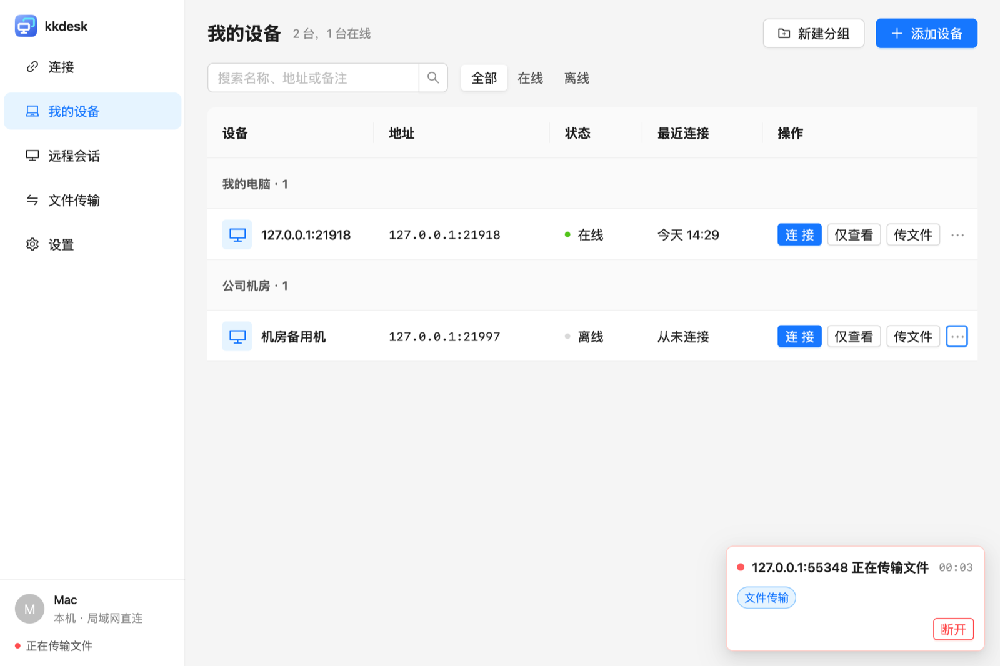
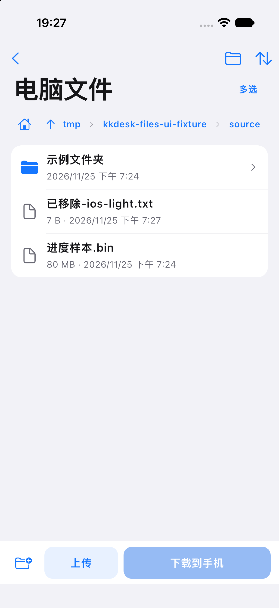

# kkdesk

**English** | [简体中文](README.zh-CN.md) | [日本語](README.ja.md)

A native remote desktop written in Go with [Tango](https://github.com/tangoui/tango). The UI is self-drawn and the remote screen is shown in the system's native video view, with hardware H.264 on both ends.

One app, two roles: share this computer's screen, or view and control another one. On a LAN, connect by address and password. Across networks, connect by device code through a server you host yourself. No third-party cloud and no account.

> The app's interface is currently in Chinese; the names of settings below are translations.

> **Status: prototype.** It works, but it has not had a first release yet. Both ends must run the same version (connection authentication v2 is not compatible with earlier builds).

## Screenshots

### Desktop (macOS)

| My devices | File transfer |
| --- | --- |
|  |  |

### Mobile (iOS)

| Device list (iPhone) | Browsing computer files |
| --- | --- |
|  |  |

## Features

- **Remote control and view-only**, with a per-session control center for quality, frame rate, view-only and window size. The remote pointer shape (hand, text beam, resize…) follows the host.
- **File transfer**: browse, upload and download files and folders, with checksums, cancel and a per-session permission switch.
- **Clipboard sync** for text, with a per-session permission switch.
- **Privacy screen**: black out the host's displays while the controller still sees and controls the desktop. The host chooses *never / ask each time / allow*.
- **Lock screen**: lock the host on disconnect (with a grace period for dropped connections), or lock it from the control center.
- **Remote unlock** *(optional component)*: with the lock screen component installed on the host, the controller sees the lock screen and can unlock it; the password can be remembered in the controller's keychain.
- **Security**: the host signs every answer with its device identity; the controller checks it against the device code or the identity remembered for that LAN address; the password is proven only inside the encrypted DTLS channel; repeated wrong passwords pause password logins.
- **My devices**: address book with groups and online checks, session history, fixed or rotating temporary passwords. Everything is stored locally.
- **Mobile app** (Flutter, `mobile/`): pair by QR code, control a computer, browse and transfer its files.
- **Self-hosted cross-network service** (`kkdesk-server`): device-code signaling and a TURN relay; clients pick a direct WebRTC path or the relay automatically.

## Platforms

| Platform | Host (share screen) | Controller | Notes |
| --- | --- | --- | --- |
| macOS | ✅ | ✅ | ScreenCaptureKit, VideoToolbox H.264, AVSampleBufferDisplayLayer, CGEvent |
| Windows x64 | ✅ (being verified on real machines) | ✅ | DXGI Desktop Duplication, Media Foundation H.264, D3D11 video processor, SendInput |
| Linux x64 / arm64 | — | file transfer only | capture and remote display are not implemented yet |
| iOS / Android | — | ✅ | Flutter app in `mobile/` |

## Getting started

Releases will be published on [GitHub Releases](https://github.com/tangoui/kkdesk/releases) and update themselves. Until the first release, build from source (below) or take a build from GitHub Actions.

1. On the computer to be controlled, turn on **Allow remote control**. The Connect page shows its LAN addresses, a temporary password and, with a cross-network service configured, its `KD-…` device code.
2. On the controlling computer, enter the address or device code and the password, then **Connect**. If *Ask before connecting* is on, the host accepts the request.

macOS hosts need the *Screen Recording* permission, and *Accessibility* to be controlled. See the [user guide](https://tangoui.github.io/kkdesk/) (Chinese) for details.

## Build from source

Requires Go 1.27 and [`tan`](https://github.com/tangoui/tango/tree/main/cmd/tan). The project uses cgo.

```sh
tan dev                                    # run the main window with hot reload
CGO_ENABLED=1 go build -o kkdesk .          # macOS build
./kkdesk -host                             # host: print addresses and a temporary password
./kkdesk -connect 192.168.1.20:21118 -password 123456   # controller
./kkdesk -selftest                         # capture, encode and input self test
scripts/build-windows.sh                   # cross-build kkdesk.exe on macOS (needs mingw-w64)
```

## Self-hosted cross-network service

`kkdesk-server` runs on a Linux server with a public IPv4 address, with either a domain and HTTPS or an IP address and a pinned public key. On Debian or Ubuntu:

```sh
curl -fsSL -o install-server.sh https://raw.githubusercontent.com/tangoui/kkdesk/main/scripts/install-server.sh &&
  sudo bash install-server.sh desk.example.com 203.0.113.10
```

Then enter the same server address and service token on both computers under *Settings › Cross-network*. See the [deployment guide](https://tangoui.github.io/kkdesk/deploy/server.html) (Chinese) for ports, manual setup and the configuration file.

## License

[GNU AGPL-3.0](LICENSE)
